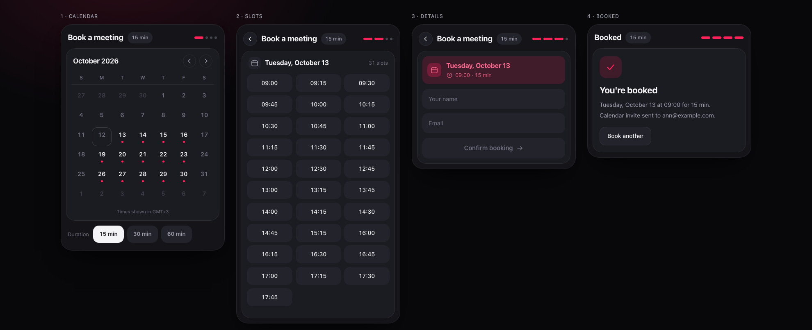
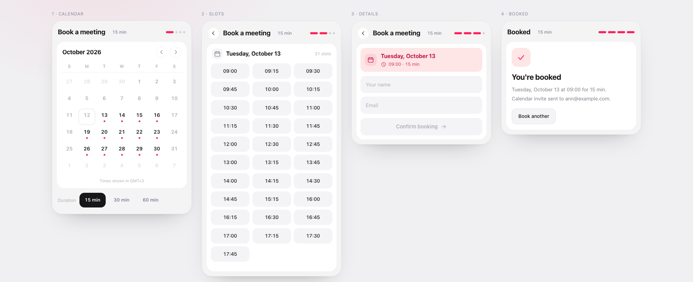

# @nickkupriyanov/slotline-react

A booking widget for React: **month calendar → time slots → details → confirmation**, in one drop-in component.

- 🌘 **Dark theme by default**, light theme included, both driven by plain CSS variables.
- 🧩 **Bring your own backend** — one small `adapter` interface (`getAvailability` / `getSlots` / `createBooking`). No vendor lock-in, no iframe, no OAuth.
- 🫧 **Soft animations out of the box** (pure CSS, zero runtime) with an optional [Motion](https://motion.dev) entry point for spring transitions.
- 🌍 **Time zones and locales done properly** — `Intl`-based, DST-safe, `en`/`ru` copy shipped, any locale tag works for formatting.
- ♿ **Accessible by default** — APG-style month grid, roving tabindex, live-region step announcements, focus management, `prefers-reduced-motion` support.
- 📦 Tiny: **~14.5 kB gzip** for the ESM bundle and **~3.6 kB gzip** of CSS, no runtime dependencies.



---

## Install

```bash
pnpm add @nickkupriyanov/slotline-react
# npm install @nickkupriyanov/slotline-react
```

`react` and `react-dom` (`^18.2 || ^19`) are peer dependencies. `motion` is optional and only needed for the `/motion` entry point.

The flow, the `Intl` date helpers, the copy, the class names and the stylesheet live in **`@nickkupriyanov/slotline-core`** — the framework-free half of Slotline, published separately so a non-React binding can reuse it. The React package depends on it, so you normally never install it by hand.

## Quick start

```tsx
import { Slotline, createMockAdapter } from '@nickkupriyanov/slotline-react';
import '@nickkupriyanov/slotline-react/styles.css';

export function BookingPage() {
  return (
    <Slotline
      adapter={createMockAdapter()} // swap for your API adapter
      theme="dark"
      locale="en"
      timeZone="Europe/Berlin"
      onBooked={(result, request) => console.log(result.id, request)}
    />
  );
}
```

The stylesheet is a separate file on purpose: it is plain CSS, so it works with any bundler, any CSS layer, and any design system. Import it once in your app.

## Wiring a real backend

The widget owns the flow and the UI; you own the data. Implement three methods:

```ts
import type { BookingAdapter } from '@nickkupriyanov/slotline-react';

export const adapter: BookingAdapter = {
  // Which days in [from, to] have free time, in the given time zone.
  async getAvailability({ from, to, duration, timeZone, signal }) {
    const response = await fetch(
      `/api/availability?from=${from}&to=${to}&duration=${duration}&tz=${timeZone}`,
      { signal },
    );
    if (!response.ok) throw new Error('Could not load availability');
    return response.json(); // DayAvailability[]
  },

  // The slots of one day — ISO instants, ideally with an offset.
  async getSlots({ date, duration, timeZone, signal }) {
    const response = await fetch(`/api/slots?date=${date}&duration=${duration}&tz=${timeZone}`, {
      signal,
    });
    if (!response.ok) throw new Error('Could not load times');
    return response.json(); // TimeSlot[]
  },

  async createBooking(request) {
    const response = await fetch('/api/bookings', {
      method: 'POST',
      headers: { 'content-type': 'application/json' },
      body: JSON.stringify(request),
    });
    if (!response.ok) throw new Error('Booking failed');
    return response.json(); // { id, inviteeEmail? }
  },
};
```

`BookingRequest` is what `createBooking` receives — everything the widget knows:

```ts
{
  slot: { start: '2026-05-18T09:15:00+02:00', end: '2026-05-18T09:30:00+02:00' },
  date: '2026-05-18',        // calendar day in `timeZone`
  duration: 15,              // minutes
  timeZone: 'Europe/Berlin',
  details: { name: 'Ann', email: 'ann@example.com' }
}
```

Every request carries an `AbortSignal` that fires when the month changes or the widget unmounts — pass it to `fetch` and stale responses take care of themselves.

A booking in flight locks the flow down: `submit()` is not re-entrant (two synchronous calls create one booking) and the back affordance is disabled. Every response carries the scenario it belongs to, so a late answer can never move the screen — not after going back, not after a different slot, not even after a `reset()` followed by booking the exact same slot again. In those cases `onBooked` still fires (the booking really exists, and the callback receives the request it belongs to) while the UI stays where the user is.

## Props

| Prop | Type | Default | Notes |
| --- | --- | --- | --- |
| `adapter` | `BookingAdapter` | — | **Required.** Data + persistence. Keep the object stable across renders. |
| `durations` | `number[]` | `[15, 30, 60]` | Duration options in minutes. |
| `duration` / `defaultDuration` | `number` | first of `durations` | Controlled / uncontrolled duration. |
| `onDurationChange` | `(minutes: number) => void` | — | Fires when the user switches duration. |
| `timeZone` | `string` | browser zone | IANA zone used for every date and time rendered. |
| `locale` | `'en' \| 'ru' \| string` | browser language | Built-in copy for `en`/`ru`; any tag works for `Intl` formatting. |
| `messages` | `Partial<SlotlineMessages>` | — | Per-string overrides merged over the locale defaults. |
| `theme` | `'dark' \| 'light' \| 'system'` | `'dark'` | Rendered as `data-sl-theme` on the root element. |
| `title` | `string` | `"Book a meeting"` | Header title; the confirmation uses its own string. |
| `minDate` / `maxDate` | `string \| Date` | today / — | Selectable range. |
| `weekStartsOn` | `0 \| 1` | `0` (Sunday) | First column of the calendar. |
| `onBooked` | `(result, request) => void` | — | After `createBooking` resolves. |
| `onError` | `(error: Error) => void` | — | Any adapter failure (also rendered inline). |
| `onDismiss` | `() => void` | — | Renders a back/close affordance on the first and last step. |
| `autoFocus` | `boolean` | `false` | Move focus into the widget on mount — useful in modals. |
| `trapFocus` | `boolean` | `false` | Keep `Tab` inside the card; `Escape` goes back. |
| `className` / `classNames` | `string` / `Partial<Record<SlotlineClassSlot, string>>` | — | Styling hooks; every part has a stable `sl-*` class. |
| `animations` | `AnimationKit` | CSS kit | Swap in the Motion kit or your own. |

### Exposed classes

`sl-root`, `sl-card`, `sl-header`, `sl-title`, `sl-badge`, `sl-progress`, `sl-panel`, `sl-footer`, `sl-calendar`, `sl-calendar-header`, `sl-month-label`, `sl-nav-button`, `sl-weekdays`, `sl-weekday`, `sl-grid`, `sl-day`, `sl-day-dot`, `sl-slots-header`, `sl-slots-count`, `sl-slots`, `sl-slot`, `sl-summary`, `sl-form`, `sl-field`, `sl-input`, `sl-submit`, `sl-error`, `sl-empty`, `sl-skeleton`, `sl-confirmation`, `sl-confirmation-icon`, `sl-confirmation-title`, `sl-confirmation-text`, `sl-secondary-button`.

## Theming

Every token is a CSS custom property on `.sl-root`. Override as many or as few as you like — no rebuild, no Tailwind, no CSS-in-JS.

The widget is exactly `--sl-width` wide on **every** step and shrinks to `100%` of a narrower parent, so advancing through the flow never resizes the card. `pnpm check:layout` measures that in a real browser, because jsdom cannot.

```css
.sl-root {
  --sl-accent: #7c5cff;
  --sl-accent-hover: #8f74ff;
  --sl-accent-ink: #ab9dff;
  --sl-accent-soft: rgba(124, 92, 255, 0.18);
  --sl-radius-card: 18px;
  --sl-width: 440px;
}
```

| Group | Tokens |
| --- | --- |
| Accent | `--sl-accent`, `--sl-accent-hover`, `--sl-accent-press`, `--sl-accent-contrast`, `--sl-accent-ink`, `--sl-accent-soft`, `--sl-accent-soft-strong`, `--sl-accent-glow` |
| Surfaces | `--sl-surface`, `--sl-surface-raised`, `--sl-panel`, `--sl-control`, `--sl-control-hover` |
| Text | `--sl-text`, `--sl-text-muted`, `--sl-text-subtle`, `--sl-ink`, `--sl-ink-contrast` |
| Lines | `--sl-border`, `--sl-border-strong`, `--sl-focus-ring` |
| Feedback | `--sl-danger`, `--sl-danger-ink`, `--sl-danger-soft` |
| Shape | `--sl-radius-card`, `--sl-radius-panel`, `--sl-radius-control`, `--sl-radius-pill`, `--sl-width`, `--sl-slot-columns` |
| Motion | `--sl-ease-soft`, `--sl-ease-standard`, `--sl-duration-fast`, `--sl-duration`, `--sl-duration-slow` |
| Type | `--sl-font-family`, `--sl-font-size` |

Light theme tokens are the same names under `.sl-root[data-sl-theme='light']`:



## Animations

The default kit is pure CSS: there is no animation library in your bundle and nothing to configure.

| Moment | Behaviour |
| --- | --- |
| Step change | 420 ms fade + 10 px slide, direction-aware (forward/back). |
| Month change | The grid fades and rises in; availability dots ripple in with an 8 ms-per-cell delay. |
| Slot list | Staggered reveal, 18 ms per item. |
| Progress | The reached pill stretches from a dot into a bar. |
| Selection | Slot lift on hover, 0.94 scale on press. |
| Confirmation | The check mark draws itself, the icon pops, the copy follows. |
| Reduced motion | `prefers-reduced-motion: reduce` collapses every animation and transition to ~0 ms. |

### Spring transitions with Motion (optional)

```tsx
import { Slotline } from '@nickkupriyanov/slotline-react/motion'; // requires `motion` (^11+)
import '@nickkupriyanov/slotline-react/styles.css';
```

The `/motion` entry point binds the same widget to a spring-based kit (`AnimatePresence` step transitions, staggered slot reveals, `whileTap`). The main entry never imports `motion`, so the peer dependency stays genuinely optional.

## Accessible by default

- The month is an ARIA grid with one tab stop; arrow keys, `Home`, `End`, `PageUp`/`PageDown` navigate.
- Every day is labelled with its full date and availability ("Monday, May 4, 2 slots") — nothing is conveyed by the dot colour alone.
- Step changes are published through a polite live region, and DOM focus follows the flow instead of falling back to `<body>` when the activated element unmounts.
- Validation messages are wired with `aria-invalid` / `aria-describedby`.
- The duration picker is a labelled `radiogroup`.
- `autoFocus` / `trapFocus` are opt-in, so an inline widget never hijacks page-level keyboard navigation.

## Time zones, DST and locales

- Availability is requested per calendar day in the widget's `timeZone` (`from`/`to` are `YYYY-MM-DD` strings), while slots are ISO **instants** — the widget renders them in the target zone with `Intl`, so DST shifts are handled by the platform.
- Slot counts, weekday names and month labels come from `Intl` too; `en` and `ru` copy ships in the box and `messages` overrides any single string.
- The zone is shown under the calendar (`Times shown in GMT+2`) so nobody books the wrong hour.

```tsx
<Slotline adapter={adapter} timeZone="Asia/Tokyo" locale="ru" />
```

## Building a custom UI

`useBookingFlow` is the whole widget without the markup, and `SlotlineProvider` exposes it to any child:

```tsx
import { SlotlineProvider, useSlotlineContext } from '@nickkupriyanov/slotline-react';

function MyPanel() {
  const { state, messages, monthLabel, monthGrid, actions, isDayBookable, timeZone, locale } =
    useSlotlineContext();

  return (
    <section>
      <h2>{monthLabel}</h2>
      {monthGrid.filter(isDayBookable).map((day) => (
        <button key={day} onClick={() => actions.selectDate(day)}>
          {day}
        </button>
      ))}
      {state.slots.map((slot) => (
        <button key={slot.start} onClick={() => actions.selectSlot(slot)}>
          {slot.start}
        </button>
      ))}
    </section>
  );
}

export const Custom = () => (
  <SlotlineProvider adapter={adapter} theme="dark">
    <MyPanel />
  </SlotlineProvider>
);
```

You can also render the built-in view inside your own provider: `<SlotlineProvider>…<SlotlineView /></SlotlineProvider>`.

## Mock adapter

`createMockAdapter({ horizonDays, workday, closedWeekdays, latency, timeZone, busyRatio })` generates a deterministic, dependency-free schedule so you can prototype, write tests, or populate Storybook without a backend.

## Development

```bash
pnpm install
pnpm dev              # playground on http://localhost:5173
pnpm storybook        # stories for every state + a11y checks
pnpm test             # vitest + testing-library (69 tests)
pnpm typecheck        # all packages
pnpm build            # core, then the React binding (tsup + CSS)
pnpm verify:install   # packs the library and builds a clean consumer app from the tarball
pnpm check:layout     # measures every step in a real browser (needs the built gallery served on :4173)
```

```
packages/core       framework-free core (@nickkupriyanov/slotline-core)
  src/styles        tokens.css → base.css → slotline.css (concatenated at build time)
packages/react      the React binding (@nickkupriyanov/slotline-react)
  src/animations    the CSS kit and the optional Motion kit
apps/playground     dev playground + state gallery (gallery.html)
tools/              screenshot + packaging verification scripts
```

## Scope and known limits

Slotline deliberately stops at the UI + flow boundary:

- No scheduling engine (working hours, buffers, recurrence, round-robin). Produce `DayAvailability` / `TimeSlot` however you like — your backend, `rrule`, Google Calendar, whatever.
- No calendar sync, reminders, payments or meeting links — that is what `createBooking` is for.
- No iframe and no hosted service: everything runs in your app, against your API.
- `weekStartsOn` supports Sunday and Monday only; other calendar systems (Hijri, Jalali, Buddhist) are not implemented.
- Width is a fixed `--sl-width`; the responsive tweaks use viewport media queries, so a very narrow *container* on a wide viewport keeps the 3-column slot grid (it still fits, it is just tighter than the 2-column fallback).
- Single-day bookings; multi-day or range selection is not part of the flow.

## License

MIT © Nick Kupriyanov
